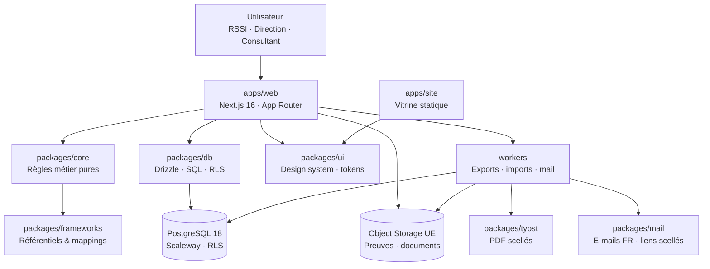

<p align="center">
  
</p>

<h1 align="center">TORON</h1>

<p align="center">
  <strong>La conformité qui se tisse, pas celle qui se duplique.</strong><br />
  <sub>Un socle unique · Plusieurs référentiels · Des preuves qui tiennent la route</sub>
</p>

<p align="center">
  <a href="docs/PLAN.md"></a>
  <a href="docs/BACKLOG.md"></a>
  <a href="SECURITY.md"></a>
</p>

<p align="center">
  <a href="#-le-produit-en-une-minute">Produit</a> ·
  <a href="#-architecture-cible">Architecture</a> ·
  <a href="#-démarrer-en-local">Démarrer</a> ·
  <a href="#-règles-non-négociables">Invariants</a> ·
  <a href="#-roadmap">Roadmap</a>
</p>

---

## ✦ Le produit en une minute

Toron est un SaaS B2B français destiné aux PME/ETI, RSSI, dirigeants et
consultants. Il unifie la conformité **ISO/IEC 27001:2022**, **NIS 2 /
ReCyF**, **RGPD**, puis **ISO 9001:2015** autour d'un même modèle de contrôles,
preuves, risques, actions et documents.

### La promesse

```text
                 1 contrôle
                     │
       ┌─────────────┼─────────────┐
       ▼             ▼             ▼
   ISO 27001      NIS 2 / ReCyF    RGPD
       │
       ▼
   1 preuve · 1 action · 1 livrable auditable
```

> **Prouvez une fois. Couvrez tout.**
>
> La mutualisation n'est pas une option cosmétique : c'est l'objet central de
> Toron. Une preuve bien rangée doit pouvoir servir plusieurs audits, plusieurs
> référentiels et plusieurs décisions.

### Les marqueurs Toron

| PILIER | PROMESSE |
|:---:|---|
| 🧵 | **Mutualisation native** — un contrôle peut couvrir plusieurs référentiels. |
| 🧠 | **EBIOS RM guidé** — une méthode exploitable par une PME, sans scanner maison. |
| ⏱️ | **Chronologie NIS 2** — 24 h / 72 h / J+30 calculés et suivis. |
| 🪪 | **Exports scellés** — PDF Typst, SHA-256 et page publique de vérification. |
| 🇪🇺 | **Souveraineté UE** — hébergement, données exportables, sous-traitance maîtrisée. |
| 📥 | **Import d'abord** — Excel/CSV comme porte d'entrée, jamais comme tunnel. |

---

## 🧭 Ce README est le DAT opérationnel

> **Statut :** référence de lecture rapide · **Source de vérité :**
> [`docs/PLAN.md`](docs/PLAN.md) · **Langue produit :** français

Le **Dossier d'Architecture Technique** est maintenu à deux niveaux :

- **Ce README** : la carte rapide, les invariants, les commandes et la checklist
  à utiliser au quotidien.
- [`docs/PLAN.md`](docs/PLAN.md) : la référence détaillée — ADR, modèle de
  données, modules métier, roadmap et hors-scope.

<details>
<summary><strong>🧭 Lire Toron dans le bon ordre</strong></summary>

1. Comprendre la vision et les invariants dans ce README.
2. Lire les ADR et le modèle de données dans [`docs/PLAN.md`](docs/PLAN.md).
3. Vérifier la phase courante avant toute feature.
4. Implémenter un module dans l'ordre migration → RLS → métier → UI.
5. Passer les gates locales avant de proposer une PR.

</details>

> **Règle d'or :** si une décision n'est pas compatible avec
> [`docs/PLAN.md`](docs/PLAN.md), elle ne part pas en production par surprise.
> Elle devient un ADR ou une entrée dans [`docs/BACKLOG.md`](docs/BACKLOG.md).

---

## 🏛️ Architecture cible

### Vue d'ensemble



### Monorepo

```text
toron/
├── apps/
│   ├── web/          # Application métier : app.toron.eu
│   └── site/         # Vitrine export statique : toron.eu
├── packages/
│   ├── db/           # Schéma, migrations, seeds, RLS
│   ├── core/         # Scoring, mutualisation, échéances, RBAC métier
│   ├── ui/           # Tokens et composants partagés
│   ├── frameworks/   # ReCyF, ISO 27001, RGPD, ISO 9001
│   ├── typst/        # Templates et génération de livrables
│   └── mail/         # Types, gabarits et scellement des liens
├── workers/          # Traitements asynchrones et service mail
├── infra/            # Docker, compose, Caddy, déploiement
└── docs/             # DAT, design, exploitation et backlog
```

### Invariants techniques

| Domaine | Décision |
|---|---|
| Runtime | Node.js **≥ 22** · pnpm **11** · TypeScript strict |
| Application | Next.js **16** · App Router · monolithe modulaire |
| Données | PostgreSQL **18** · Drizzle via `withTenant()` uniquement |
| Isolation | `tenant_id` + RLS + `SET LOCAL app.tenant_id` |
| Authentification | Better Auth auto-hébergée · argon2id · TOTP pour Admin/RSSI |
| Fichiers | Object Storage UE · allowlist · hash à l'ingestion · URLs courtes |
| PDF | Typst côté serveur · jamais de « print to PDF » navigateur |
| E-mails | `email_outbox` + transport Scaleway TEM abstrait par `Mailer` |
| Identifiants | UUID partout · aucun identifiant séquentiel exposé |

<p align="center">
  <strong>🔒 Secure by design</strong> &nbsp;·&nbsp;
  <strong>🇪🇺 UE-first</strong> &nbsp;·&nbsp;
  <strong>🧵 Cross-mapping natif</strong> &nbsp;·&nbsp;
  <strong>📄 Livrables auditables</strong>
</p>

<details>
<summary><strong>⚖️ Les décisions qui ne se négocient pas</strong></summary>

| Décision | Pourquoi |
|---|---|
| **Pas de requête DB hors `withTenant()`** | L'isolation multi-tenant est une propriété du système, pas une convention d'équipe. |
| **Pas de logique métier dans React** | Les règles doivent rester testables, réutilisables et indépendantes de l'interface. |
| **Pas de texte ISO intégral** | Les clauses sont identifiées et reformulées ; le contenu protégé ne doit pas entrer dans le produit. |
| **Pas de “fallback” silencieux** | Une erreur doit expliquer la cause, la correction et porter un `correlationId`. |
| **Pas de sous-traitant US par défaut** | La souveraineté européenne est une contrainte produit et architecture. |

</details>

---

## 🚀 Démarrer en local

<table>
  <tr>
    <td><strong>1 · Installer</strong><br /><code>pnpm install</code></td>
    <td><strong>2 · Développer</strong><br /><code>pnpm dev</code></td>
    <td><strong>3 · Prouver</strong><br /><code>pnpm lint && pnpm typecheck && pnpm test</code></td>
  </tr>
</table>

### Pré-requis

- Node.js **22 ou supérieur**
- pnpm **11**
- Docker et Docker Compose

### Installation

```bash
pnpm install
```

### Lancer l'environnement de développement

```bash
# Application métier
pnpm dev

# Vitrine, dans un autre terminal si nécessaire
pnpm --filter @toron/site dev
```

Pour l'environnement complet avec PostgreSQL :

```bash
docker compose -f infra/compose.yaml up --build
```

> Après une mise à niveau de PostgreSQL, un volume local créé avec une
> ancienne version peut nécessiter : `docker compose -f infra/compose.yaml down -v`.
> Cette commande supprime les données locales du volume Docker.

### Base de données et données de démo

Les migrations utilisent un rôle DDL séparé du rôle applicatif :

```bash
DATABASE_URL_MIGRATIONS="..." pnpm --filter @toron/db migrate
DATABASE_URL_MIGRATIONS="..." pnpm --filter @toron/db seed
```

Le seed est idempotent et fournit notamment le tenant de démonstration
**Meridiane Logistics** : 148 salariés, 3 sites, périmètre SMSI + QMS.

### Les trois gates locales

```bash
pnpm lint
pnpm typecheck
pnpm test
```

Avant une livraison complète :

```bash
pnpm build
```

---

## 🔐 Règles non négociables

### Données et tenants

- Toute table métier possède `id uuid`, `tenant_id uuid NOT NULL`,
  `created_at` et `updated_at`.
- Toute requête passe par `withTenant(tenantId, fn)`.
- Le rôle applicatif n'a **jamais** `BYPASSRLS`.
- Chaque module apporte des tests de lecture **et d'écriture** cross-tenant.
- `audit_log` est append-only : aucune API d'effacement.

### Sécurité applicative

- Zod à chaque frontière : API, server actions, imports, webhooks et variables
  d'environnement.
- RBAC côté serveur ; l'interface ne fait que refléter les droits.
- Erreurs standardisées : `{ code, message, correlationId }`, sans stack trace
  côté client.
- Aucun secret, contenu de preuve ou PII dans les logs.
- CSP stricte, HSTS, CSRF sur les mutations et rate limiting sur l'authentification
  et les endpoints publics.
- Fonctions `SECURITY DEFINER` : `search_path` durci et privilèges retirés à
  `PUBLIC`.

### Produit et contenu

- Les règles métier vivent dans `packages/core`, jamais dans les composants
  React.
- Les tokens de couleur et d'espacement viennent de `packages/ui`.
- Les normes ISO sont citées par identifiants de clauses et reformulations
  maison uniquement ; aucun texte intégral AFNOR.
- Les demandes hors phase vont dans [`docs/BACKLOG.md`](docs/BACKLOG.md), pas
  directement dans le code.

---

## 🔁 Flux de travail d'un module

Un module Toron est livré dans cet ordre, sans exception :

```text
01  Migration SQL
     ↓
02  Politiques RLS + rôles DB
     ↓
03  Tests d'isolation cross-tenant
     ↓
04  Règles métier pures dans packages/core
     ↓
05  Tests unitaires des règles
     ↓
06  API / server actions validées par Zod
     ↓
07  UI avec les tokens de packages/ui
     ↓
08  Parcours e2e Playwright
     ↓
09  Lint · typecheck · tests · revue OWASP
```

### Définition de terminé

- [ ] Migration réversible et testée
- [ ] RLS activée, forcée si nécessaire, et rôle runtime vérifié
- [ ] Tests d'isolation lecture/écriture verts
- [ ] Règles métier pures et testées
- [ ] Erreurs explicites et corrélées
- [ ] Audit log alimenté pour les actions significatives
- [ ] Parcours principal couvert en e2e
- [ ] Données de démo cohérentes
- [ ] `pnpm lint`, `pnpm typecheck` et `pnpm test` verts
- [ ] Checklist OWASP du module parcourue

---

## 🗺️ Roadmap

| Phase | Objectif | Critère de sortie |
|---|---|---|
| **M0** | Fondations, auth, tenants, RLS, audit, design system | Un second tenant ne lit rien du premier ; Docker fonctionne |
| **MVP** | Socle GRC démontrable, import, actions, preuves, exports scellés | Import Excel → évaluation ReCyF → actions → SoA en 15 min |
| **V1** | Crédibilité RSSI : EBIOS, incidents, audits, fournisseurs | Parcours opérationnels et notifications fiables |
| **V2** | Pack QMS, SSO, API, continuité | Processus, NC/CAPA et entreprise couverts |
| **V3** | Connecteurs, IA souveraine, DORA, ISO 14001 | Expansion sans compromettre la souveraineté |

> On ne démarre jamais une phase avant que la DoD de la précédente soit verte.

---

## 📚 Références d'architecture

| Document | Rôle |
|---|---|
| [`docs/PLAN.md`](docs/PLAN.md) | Référence produit et technique complète |
| [`CLAUDE.md`](CLAUDE.md) | Conventions exécutoires pour le développement |
| [`docs/devsecops.md`](docs/devsecops.md) | Chaîne de livraison et contrôles DevSecOps |
| [`docs/exploitation-courriel.md`](docs/exploitation-courriel.md) | Exploitation du service mail |
| [`docs/toron-prompts-claude-design.md`](docs/toron-prompts-claude-design.md) | Spécification des écrans |
| [`docs/design/`](docs/design/) | Maquettes et identité visuelle — référence, pas code à copier |
| [`SECURITY.md`](SECURITY.md) | Signalement et politique de sécurité |

---

## 🧵 Philosophie

Toron ne collectionne pas les fonctionnalités.

Il transforme une même réalité opérationnelle — un contrôle, une preuve, une
action — en plusieurs couvertures de conformité **sans dupliquer le travail**.

**Une source. Plusieurs référentiels. Des livrables vérifiables.**
